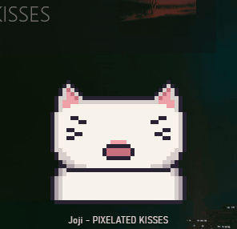
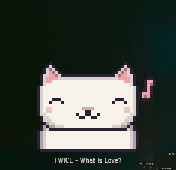
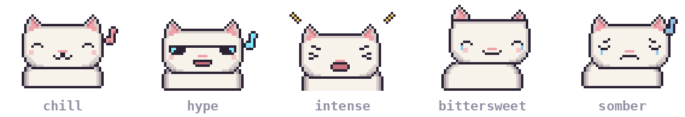

<p align="center">
  
</p>

<h1 align="center">Vibecat</h1>

<p align="center">
  A desktop cat that vibes to whatever you're playing. On beat. In the right mood. And it knows when the chorus hits.
</p>

<p align="center">
  
  
  
  
</p>

---

## Why this exists

I found a cat that bobs its head to the BPM of your song. My ADHD brain loved it. It was also kind of bad.

It only lived inside Spotify. So to see the cat, I had to keep Spotify open next to whatever I was actually doing. Word on one side, cat on the other. Not ideal.

It also headbanged to everything. Sad song? Headbang. Lullaby? Headbang. And half the time it wasn't even on the beat.

So I made my own. It sits on top of everything, it works with whatever music app you use, and it actually reads the room.

## What it does

- **Bops on the beat.** Every frame is worked out from where you are in the song, so it stays in sync even if you skip around.
- **Has moods.** Chill, hype, intense, bittersweet, somber. A sad song gets a sad cat. As it should.
- **Drops on the chorus.** When the chorus or a hook comes in, the cat switches to its drop animation. Lasers, disco ball, the works.
<p align="center">
  
</p>

- **Skins.** The cat is the default. More characters are on the way, and any skin falls back to the cat for moods it doesn't have yet.
- **Remembers songs.** Song metrics are cached in Firebase, so every song only gets looked up once.
- **Stays out of your way.** Lives in the tray. Turn on click through and it ignores your mouse completely.

## The moods

<p align="center">
  
</p>

Every song gets a mood from its vibe and energy. A weighted points system helps pick the closest mood. Happy and loud gets hype. Sad and loud gets intense. Sad and quiet gets the waterworks. 

<p align="center">
  <br>
  <sub>He's going through it.</sub>
</p>

## How it works

The fun part. Short version below, details if you click.

<details>
<summary><b>Finding the song, without asking Spotify for permission</b></summary>

Most "now playing" projects need a login to one specific streaming service. Vibecat doesn't. It asks Windows.

Windows already knows what's playing, because it shows it in the media controls. A small PowerShell script reads that from the Windows media session (title, artist, position, length) and hands it to the app as JSON. Any app that shows up there works. YouTube Music, Spotify, whatever.

</details>

<details>
<summary><b>Staying on beat with a 3 second check-in</b></summary>

Windows only gets asked every 3 seconds. That's way too slow to animate from directly.

So each check-in is treated as a snapshot: "at this moment, the song was at this position". Between snapshots the app just does the maths. Position now = snapshot position + time since the snapshot. Paused? Then it stays put.

From the position and the BPM, the frame number falls out on its own. Which means the cat is always on the beat, without ever counting beats.

</details>

<details>
<summary><b>Picking the right lyrics</b></summary>

Chorus detection needs synced lyrics (lines with timestamps). Those come from LRCLIB, which is crowdsourced. So one song can have ten versions: album, radio edit, sped up, music video.

They have the same name. They don't have the same length. So Vibecat picks the version whose length is closest to the song actually playing, and only trusts it within 2 seconds.

I tested it on a bunch of songs before picking that number. Everything that had lyrics matched within half a second. Even music videos, because people sync lyrics to those too.

</details>

<details>
<summary><b>Finding the chorus</b></summary>

Listening to the audio didn't work. Modern songs are loud everywhere, so the chorus is barely louder than the verse.

Lyrics work better, because a chorus is the part that comes back. So:

1. Find the longest block of lines that shows up at least twice.
2. Find every copy of it, including ones that start partway in.
3. Cross those out and do it again, to catch hooks too.
4. Stop when nothing repeats for at least 3 lines.

Each copy turns into a start and end time. The cat checks those every frame.

</details>

## Run it

Windows only :P

```bash
git clone https://github.com/waskronos/vibecat.git
cd vibecat
npm install
npm start
```

Play something. The cat will figure out the rest.

## Credits

- **Raymond Chen** and The Old New Thing, for the example of reading the Windows media session. The PowerShell script follows it
- **songbpm.com**, for every tempo, key and mood
- **LRCLIB**, for the synced lyrics
- **[Cat Jam Synced](https://github.com/BlafKing/spicetify-cat-jam-synced)** by BlafKing, the Spicetify extension that started all this. For the idea and the ADHD dopamine
